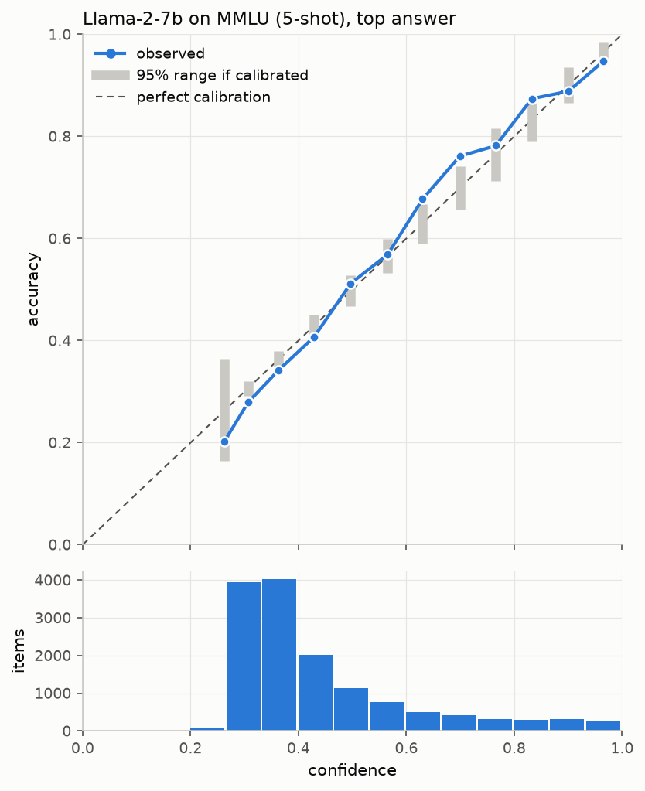
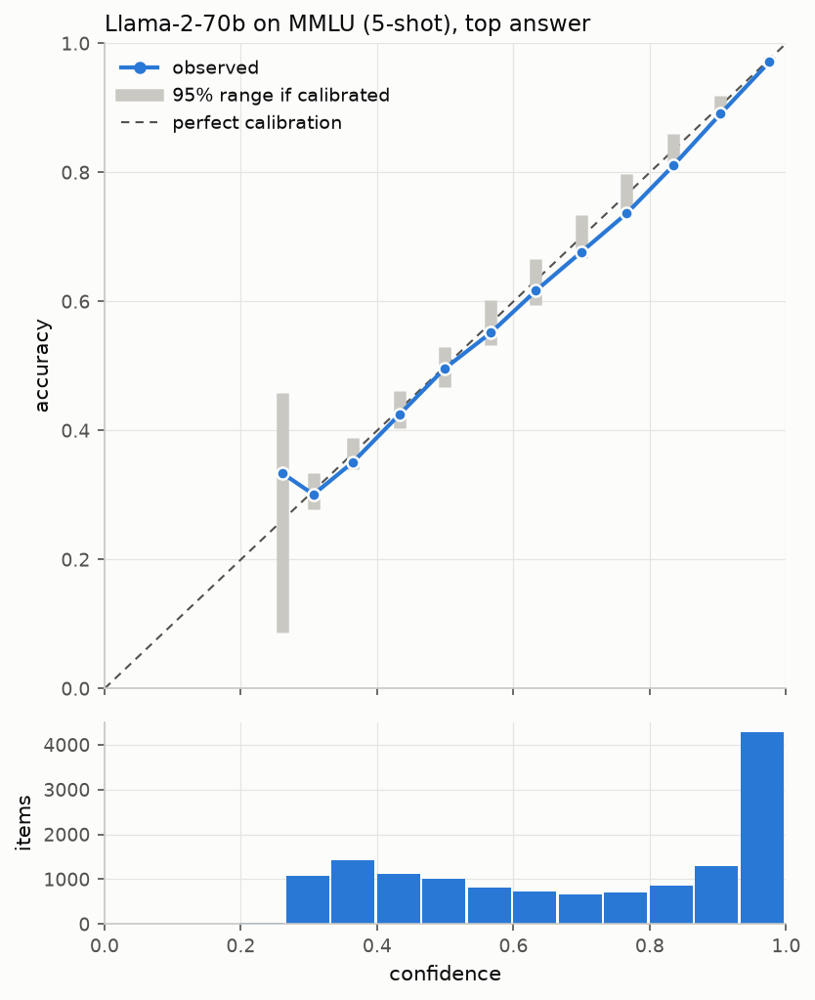

# calibcheck

Measure how well a model's stated confidence matches how often it is right, with intervals,
and test whether recalibration on held-out data fixes it.

## Why this is hard

The usual estimator of calibration error is biased upward and depends on the binning. With a
finite number of items per bin, a perfectly calibrated model still shows a gap between accuracy
and mean confidence in every bin, so a small non-zero number can come from the estimator
rather than from the model. Recalibration has a matching trap: a map fitted and scored on the
same items always looks good. calibcheck reports the plug-in and the debiased estimate side by
side, puts a bootstrap interval on every metric of a model, tests the result against what a
calibrated model would show, and scores recalibration on items the map was not fitted on.

## Install

```
pip install git+https://github.com/vipul21435/calibcheck
```

Python 3.10 or later. The only runtime dependency is numpy; `pip install
"calibcheck[plot] @ git+https://github.com/vipul21435/calibcheck"` adds matplotlib for the
`diagram` command.

## Quickstart

The input is a JSONL or CSV file with one item per line: a confidence in [0, 1] and whether
the answer was correct (or a probability vector and a label, see "Input").

```
{"id": "q001", "confidence": 0.7, "correct": true}
{"id": "q002", "confidence": 0.9, "correct": true}
```

`examples/example.jsonl` holds 400 simulated items. They are not measurements of any model;
`examples/make_example.py` draws them from a process that is overconfident at 0.7 and above
and slightly underconfident below.

```
$ calibcheck metrics examples/example.jsonl --binning mass
# Calibration report: examples/example.jsonl

400 items, 7 equal-mass bins.
95% intervals: percentile bootstrap over items, 1000 resamples.

| metric | value | 95% interval |
|---|---|---|
| accuracy | 0.7150 | [0.6725, 0.7575] |
| mean confidence | 0.8300 | [0.8172, 0.8420] |
| ECE, plug-in | 0.1210 | [0.0896, 0.1670] |
| ECE, debiased | 0.1126 | [0.0782, 0.1636] |
| MCE | 0.2439 | [0.1617, 0.3830] |
| squared calibration error, plug-in | 0.0183 | [0.0112, 0.0346] |
| squared calibration error, debiased | 0.0146 | [0.0077, 0.0308] |
| L2 calibration error, plug-in | 0.1352 | [0.1056, 0.1861] |
| L2 calibration error, debiased | 0.1207 | [0.0878, 0.1756] |
| Brier score | 0.2158 | [0.1876, 0.2446] |
| reliability | 0.0183 | [0.0112, 0.0346] |
| resolution | 0.0062 | [0.0028, 0.0192] |
| uncertainty | 0.2038 | [0.1837, 0.2202] |
| within-bin term | 0.0000 | [0.0000, 0.0000] |
| log loss | 1.2696 | [0.8624, 1.7081] |
| AUROC | 0.5833 | [0.5217, 0.6456] |
| AURC | 0.2443 | [0.1873, 0.3016] |
| accuracy at 80% coverage | 0.7423 | [0.6968, 0.7873] |

| bin | items | mean confidence | accuracy | gap |
|---|---|---|---|---|
| [0.000, 0.600) | 17 | 0.5000 | 0.4706 | -0.0294 |
| [0.600, 0.700) | 28 | 0.6000 | 0.5357 | -0.0643 |
| [0.700, 0.800) | 44 | 0.7000 | 0.7273 | 0.0273 |
| [0.800, 0.900) | 108 | 0.8000 | 0.7037 | -0.0963 |
| [0.900, 0.950) | 108 | 0.9000 | 0.7500 | -0.1500 |
| [0.950, 1.000) | 54 | 0.9500 | 0.7963 | -0.1537 |
| [1.000, 1.000] | 41 | 1.0000 | 0.7561 | -0.2439 |

| coverage | 10% | 20% | 30% | 40% | 50% | 60% | 70% | 80% | 90% | 100% |
|---|---|---|---|---|---|---|---|---|---|---|
| accuracy | 0.7561 | 0.7757 | 0.7729 | 0.7672 | 0.7638 | 0.7543 | 0.7471 | 0.7423 | 0.7380 | 0.7150 |
```

The last table is the risk-coverage curve at ten points: the accuracy on the most confident
10 %, 20 %, ... of the items.

Because the example is simulated, the error of the process behind it is known:
`python examples/make_example.py` prints a squared calibration error of 0.0087 and an ECE of
0.0833. On these 400 draws the plug-in estimates are 0.0183 and 0.1210 and their intervals
miss the known values; the debiased estimates are 0.0146 and 0.1126 and their intervals
contain them. That is one sample; `python examples/bias_simulation.py` averages over 3000.

Recalibration is scored on held-out folds. `--in-sample` adds, for contrast, the same maps
fitted and scored on the same items:

```
$ calibcheck recalibrate examples/example.jsonl --in-sample
# Recalibration report: examples/example.jsonl

400 items; each map is fitted on 4 of 5 folds and scored on the held-out fold. Metrics use 15 equal-width bins.

| method | fitted on | ECE, plug-in | ECE, debiased | L2 CE, debiased | Brier | top-label log loss | AUROC |
|---|---|---|---|---|---|---|---|
| none | - | 0.1210 | 0.1126 | 0.1206 | 0.2158 | 1.2696 | 0.5833 |
| temperature | 5 folds | 0.1752 | 0.1738 | 0.1746 | 0.2336 | 0.6637 | 0.5718 |
| temperature | same items (optimistic) | 0.1750 | 0.1747 | 0.1758 | 0.2331 | 0.6606 | 0.5833 |
| platt | 5 folds | 0.0556 | 0.0537 | 0.0473 | 0.2056 | 0.6025 | 0.4709 |
| platt | same items (optimistic) | 0.0039 | -0.0152 | 0.0000 | 0.2033 | 0.5966 | 0.5833 |
| isotonic | 5 folds | 0.0339 | 0.0164 | 0.0170 | 0.2026 | 0.5954 | 0.5364 |
| isotonic | same items (optimistic) | 0.0000 | -0.0326 | 0.0000 | 0.1977 | 0.5837 | 0.5864 |
| histogram | 5 folds | 0.0570 | 0.0424 | 0.0705 | 0.2039 | 0.5986 | 0.5338 |
| histogram | same items (optimistic) | 0.0000 | -0.0326 | 0.0000 | 0.1975 | 0.5833 | 0.5895 |
```

Isotonic regression and histogram binning reach an ECE of exactly zero on the items they were
fitted on; held out, they do not. Temperature scaling makes this example worse: a tenth of
the items state a confidence of exactly 1, whose logit is unbounded, and one temperature
cannot pull those down without flattening everything else (see Limitations).

`compare` takes two models on the same items and reports each metric, the difference and a
paired bootstrap interval; with vectors in both files that includes the classwise ECE and the
log loss and Brier score of the whole vector. `examples/example_b.jsonl` is a second simulated model on the same
400 items, calibrated by construction. The first rows of the output:

```
$ calibcheck compare examples/example.jsonl examples/example_b.jsonl --id id
# Calibration comparison

A: examples/example.jsonl
B: examples/example_b.jsonl

400 items matched by id. Differences are A - B; 95% intervals: paired bootstrap over items, 1000 resamples.

| metric | A | B | A - B | 95% interval |
|---|---|---|---|---|
| accuracy | 0.7150 | 0.7525 | -0.0375 | [-0.0925, 0.0175] |
| mean confidence | 0.8300 | 0.7564 | 0.0736 | [0.0678, 0.0790] |
| ECE, plug-in | 0.1210 | 0.0388 | 0.0822 | [0.0273, 0.1273] |
| ECE, debiased | 0.1126 | 0.0281 | 0.0845 | [0.0224, 0.1397] |
```

`diagram` writes a reliability diagram with consistency bands and prints a test of
calibration (it needs the `plot` extra):

```
$ calibcheck diagram examples/example.jsonl --binning mass --output reliability.png
wrote reliability.png
consistency test: plug-in ECE 0.1210; under calibration its mean is 0.0334 and its 95% quantile 0.0521; p = 0.0010 (1000 resamples)
```

Every command takes `--bins`, `--binning
width|mass` and `--seed`, and all but `diagram` take `--format json`. `python
examples/quickstart.py` shows the same steps from Python.

### Input

| what the file holds | options |
|---|---|
| a confidence and a correctness flag | `--confidence FIELD --correct FIELD` (the defaults are those names) |
| a probability vector and the true class index | `--probs FIELD --label FIELD` |
| a vector of logits or log-likelihoods | `--logits FIELD --label FIELD` |
| confidence as text ("85%", "0.85", "high") | `--stated`, `--words map.json`, `--scale auto\|unit\|percent` |
| a group per item (topic, document, source) | `--group FIELD`: resample and split whole groups |

With vectors the confidence is the largest probability (top-label) and the report adds the
classwise ECE and the log loss and Brier score of the whole vector. With `--stated` the report
adds how many distinct values the model used and how often it chose multiples of 5 and 10.
A bare number is read as a probability up to 1 and as a percentage from 10 to 100; between 1
and 10 it is rejected as ambiguous (1.5 could be 1.5 %, a score out of ten or a typo) unless
it carries a percent sign or `--scale` says which.
The built-in word scale has five steps (very low 0.1, low 0.3, medium 0.5, high 0.7, very high
0.9); it is a convention, so pass the map that matches your own prompt.

## How it works

Item `i` has confidence `c_i` and outcome `y_i` (1 if correct). Bin `b` holds `n_b` of the
`n` items, with mean confidence `conf_b` and accuracy `acc_b`.

**Bins.** Equal-width bin `i` of `B` is `[i/B, (i+1)/B)`, the last one closed at 1. Guo et
al. (2017) write `((m-1)/M, m/M]`; the two conventions differ only for values exactly on an
edge, which is common for stated confidences such as 0.8 or 0.9. Edges are computed as the
correctly rounded `i/B`, so 0.3 always falls in the bin that starts at 0.3. For equal-mass
bins the sorted confidences are cut at positions `k*n // B` and each edge is the value found
at a cut; tied confidences stay in one bin, duplicate edges collapse (so there can be fewer
bins than requested) and no bin is empty.

**ECE and MCE** (Naeini et al., 2015, in the form of Guo et al., 2017, who use 15 bins, the
default here):

```
ECE = sum_b (n_b / n) * |acc_b - conf_b|        MCE = max_b |acc_b - conf_b|
```

**Squared calibration error** (Kumar, Liang and Ma, 2019, Definitions 5.1 and 5.2):

```
plug-in   = sum_b (n_b / n) * (conf_b - acc_b)^2
debiased  = sum_b (n_b / n) * [ (conf_b - acc_b)^2 - acc_b * (1 - acc_b) / (n_b - 1) ]
```

`acc_b` is a mean of `n_b` outcomes, so the squared gap overshoots the true one by the
variance of that mean; `acc_b * (1 - acc_b) / (n_b - 1)` is an unbiased estimate of that
variance. The paper states the estimator for a model whose output is constant within a bin.
Here `conf_b` is the bin's mean confidence, so the within-bin spread of the confidences is
ignored; it is small for narrow bins. The debiased value can be negative. The L2 calibration
error is its square root, clipped at zero first. A bin with a single item has no variance
estimate and adds nothing to the debiased value; the report says how many such bins there are.

**Debiased ECE** (the same paper, Definition G.3, which it calls a heuristic). Redraw each bin
accuracy as `R_b ~ N(acc_b, acc_b * (1 - acc_b) / n_b)` and subtract the expected excess:

```
debiased ECE = ECE - ( E[ sum_b (n_b / n) * |conf_b - R_b| ] - ECE )
```

The paper estimates the expectation by simulation; `E|conf_b - R_b|` is the mean of a folded
normal, so calibcheck computes it in closed form. This reduces the bias and does not remove
it. Averages over 3000 simulated samples of 200 items with a known truth:

```
$ python examples/bias_simulation.py
true ECE | plug-in ECE | debiased ECE | true sq. | plug-in sq. | debiased sq.
  0.0000 |      0.0675 |       0.0402 |   0.0000 |      0.0075 |      -0.0000
  0.0500 |      0.0807 |       0.0560 |   0.0025 |      0.0103 |       0.0025
  0.1000 |      0.1121 |       0.0944 |   0.0100 |      0.0180 |       0.0101
```

The debiased squared error is on target in every row. The debiased ECE removes about 40 % of
the bias at a true error of zero and overshoots downward at 0.1; treat it as a correction,
not as an unbiased estimate.

**Brier score** (Brier, 1950) is `mean((c_i - y_i)^2)`. Murphy (1973) partitions it as

```
Brier = reliability - resolution + uncertainty
reliability = sum_b (n_b / n) * (conf_b - acc_b)^2
resolution  = sum_b (n_b / n) * (acc_b - mean(y))^2
uncertainty = mean(y) * (1 - mean(y))
```

which is exact when the confidence is constant within each bin. Otherwise the report adds a
within-bin term, `Brier - (reliability - resolution + uncertainty)`, equal to the within-bin
variance of the confidences minus twice their within-bin covariance with the outcomes. The
reliability term is the plug-in squared calibration error.

**Top-label and classwise.** With probability vectors, top-label metrics use the largest
probability and whether that class is right. The classwise ECE bins the probability of each
class against `label == k` and averages over the `K` classes; with equal-width bins this is
the static calibration error of Nixon et al. (2019).

**Ranking.** AUROC is the probability that a right answer has higher confidence than a wrong
one (ties count one half). The risk-coverage curve gives the error rate among the `k` most
confident items for every `k` (selective prediction, Geifman and El-Yaniv, 2017); AURC is its
mean and "accuracy at 80% coverage" one point on it. Tied confidences cannot be ordered, so
within a run of ties the errors are spread evenly, which is the expectation over a random
order. These three do not measure calibration; they are reported because a recalibration map
can change them.

**Intervals.** Every metric gets a percentile interval from a bootstrap over items, or over
whole groups when `--group` is given, since items that share a topic or a prompt are not
independent. `compare` resamples the same items for both models and reports the interval of
the difference.

**Consistency resampling** (Bröcker and Smith, 2007). Draw confidences with replacement,
then draw each outcome as a coin flip with that confidence. The surrogate data are calibrated
by construction, so the spread of their bin accuracies is the band a calibrated model would
stay in, and the share of surrogates whose plug-in ECE is at least the observed one is a
p-value for "calibrated". The bias of the plug-in ECE cancels here because the surrogates
carry the same bias.

**Recalibration** (the four maps as described by Guo et al., 2017). Temperature scaling
`sigmoid(logit(c) / T)`, or `softmax(z / T)` on a whole vector, with `T` minimising the log
loss over [0.01, 100] (a search that ends on an edge of that range, as when every answer is
right, is reported with a warning because it is not a fitted temperature); Platt scaling `sigmoid(a * logit(c) + b)` by maximum likelihood; isotonic regression by
pool adjacent violators, interpolated linearly; histogram binning with equal-mass bins. Items
are split into folds (whole groups with `--group`), each map is fitted on all folds but one and
applied to the held-out fold, and the metrics are computed on the pooled held-out predictions.
`--fit-on FILE` fits on a separate file instead.

**Stated confidence.** Kadavath et al. (2022) and Tian et al. (2023) study confidence that a
language model states about its own answer. `--stated` reads such values ("85%", "0.85",
phrases from a configurable map) and reports their digit preference.

References:

- G. W. Brier (1950). Verification of forecasts expressed in terms of probability. Monthly
  Weather Review 78(1), 1-3.
- A. H. Murphy (1973). A new vector partition of the probability score. Journal of Applied
  Meteorology 12(4), 595-600.
- J. Bröcker, L. A. Smith (2007). Increasing the reliability of reliability diagrams. Weather
  and Forecasting 22(3), 651-661.
- M. P. Naeini, G. Cooper, M. Hauskrecht (2015). Obtaining well calibrated probabilities using
  Bayesian binning. Proceedings of the AAAI Conference on Artificial Intelligence 29(1).
- C. Guo, G. Pleiss, Y. Sun, K. Q. Weinberger (2017). On calibration of modern neural
  networks. https://arxiv.org/abs/1706.04599
- Y. Geifman, R. El-Yaniv (2017). Selective classification for deep neural networks.
  https://arxiv.org/abs/1705.08500
- A. Kumar, P. Liang, T. Ma (2019). Verified uncertainty calibration. NeurIPS 2019.
  https://arxiv.org/abs/1909.10155
- J. Nixon, M. Dusenberry, G. Jerfel, T. Nguyen, J. Liu, L. Zhang, D. Tran (2019). Measuring
  calibration in deep learning. https://arxiv.org/abs/1904.01685
- S. Kadavath and 35 others (2022). Language models (mostly) know what they know.
  https://arxiv.org/abs/2207.05221
- K. Tian, E. Mitchell, A. Zhou, A. Sharma, R. Rafailov, H. Yao, C. Finn, C. D. Manning
  (2023). Just ask for calibration: strategies for eliciting calibrated confidence scores from
  language models fine-tuned with human feedback. EMNLP 2023. https://arxiv.org/abs/2305.14975

## Results on real public data

**Data.** The archived Open LLM Leaderboard keeps, for every model it evaluated, per-question
details on the Hugging Face Hub. The two datasets used here are
[details_meta-llama__Llama-2-7b-hf](https://huggingface.co/datasets/open-llm-leaderboard-old/details_meta-llama__Llama-2-7b-hf)
and
[details_meta-llama__Llama-2-70b-hf](https://huggingface.co/datasets/open-llm-leaderboard-old/details_meta-llama__Llama-2-70b-hf).
For each of the 14,042 test questions of MMLU ([cais/mmlu](https://huggingface.co/datasets/cais/mmlu),
57 subjects, four choices; five-shot prompt) they hold the log-likelihood the model gave to
each of the four answer letters and the index of the right one; a softmax over the four
values is the model's probability vector.

**Licence.** Neither dataset page states one: the metadata has no licence field and the
"Licensing Information" section of the card reads "[More Information Needed]" (checked on
2026-11-13). So no rows are committed here. `scripts/fetch_leaderboard_details.py` downloads
the files (about 26 MB per model) and keeps the scores, the answer index and the subject, not
the question text; only the numbers below and the two diagrams are derived from them. MMLU
itself states the MIT licence on its page.

```
uv run --with pyarrow python scripts/fetch_leaderboard_details.py \
    --repo open-llm-leaderboard-old/details_meta-llama__Llama-2-7b-hf \
    --run 2023-08-29T17:54:59.197645 --out data/llama-2-7b.jsonl
uv run --with pyarrow python scripts/fetch_leaderboard_details.py \
    --repo open-llm-leaderboard-old/details_meta-llama__Llama-2-70b-hf \
    --run 2023-08-22T13:47:53.141854 --out data/llama-2-70b.jsonl

calibcheck metrics data/llama-2-7b.jsonl --logits logits --group subject
calibcheck metrics data/llama-2-70b.jsonl --logits logits --group subject
calibcheck diagram data/llama-2-7b.jsonl --logits logits \
    -o docs/reliability-llama-2-7b.png --title "Llama-2-7b on MMLU (5-shot), top answer"
calibcheck diagram data/llama-2-70b.jsonl --logits logits \
    -o docs/reliability-llama-2-70b.png --title "Llama-2-70b on MMLU (5-shot), top answer"
calibcheck recalibrate data/llama-2-7b.jsonl --logits logits --group subject --in-sample
calibcheck compare data/llama-2-7b.jsonl data/llama-2-70b.jsonl --logits logits --id id \
    --group subject
```

Top-label metrics with 15 equal-width bins. Intervals are 95 % percentile intervals from a
bootstrap over the 57 subjects (1000 resamples, seed 0):

| metric | Llama-2-7b | Llama-2-70b |
|---|---|---|
| accuracy | 0.4276 [0.3814, 0.4725] | 0.6919 [0.6305, 0.7483] |
| ECE, plug-in | 0.0241 [0.0135, 0.0424] | 0.0110 [0.0077, 0.0282] |
| ECE, debiased | 0.0229 [0.0104, 0.0414] | 0.0085 [0.0035, 0.0275] |
| L2 calibration error, debiased | 0.0233 [0.0147, 0.0449] | 0.0045 [0.0000, 0.0319] |
| classwise ECE, plug-in | 0.0343 [0.0285, 0.0458] | 0.0136 [0.0124, 0.0244] |
| Brier score | 0.2126 [0.2059, 0.2186] | 0.1509 [0.1301, 0.1726] |
| AUROC | 0.6890 [0.6614, 0.7146] | 0.8330 [0.8013, 0.8565] |
| AURC | 0.3968 [0.3419, 0.4603] | 0.1114 [0.0769, 0.1599] |
| plug-in ECE of a calibrated model (mean, 95 % quantile) | 0.0090, 0.0132 | 0.0085, 0.0117 |
| consistency test, p | 0.0010 | 0.1079 |

The last two rows come from the `diagram` command (1000 surrogates; 0.0010 is the smallest
p-value that 1000 surrogates can give). That test treats the questions as independent, which
makes it reject more readily than a test over subjects would.




Recalibration of Llama-2-7b, each map fitted on four folds of subjects and scored on the
fifth (`recalibrate`, above):

| method | fitted on | ECE, plug-in | ECE, debiased | top-label log loss |
|---|---|---|---|---|
| none | - | 0.0241 | 0.0229 | 0.6135 |
| temperature on the four-way vector | 5 folds | 0.0232 | 0.0220 | 0.6138 |
| temperature on the top-label confidence | 5 folds | 0.0123 | 0.0103 | 0.6130 |
| Platt | 5 folds | 0.0105 | 0.0075 | 0.6131 |
| isotonic | 5 folds | 0.0106 | 0.0072 | 0.6211 |
| isotonic | same items (optimistic) | 0.0000 | -0.0089 | 0.6099 |
| histogram | 5 folds | 0.0177 | 0.0157 | 0.6155 |
| histogram | same items (optimistic) | 0.0000 | -0.0081 | 0.6129 |

The five temperatures fitted on the four-way vectors were 1.019, 1.047, 1.037, 1.063 and
1.026. The last column is the binary log loss of the top-label confidence. The log loss of
the whole four-way vector, which is what temperature scaling of the vector minimises, is
1.2297 before and 1.2298 after on the held-out folds (printed under the table by the same
command).

**What this shows, stated carefully.**

- The plug-in ECE of Llama-2-70b, 0.0110, is not evidence of miscalibration. A calibrated
  model with the same confidences would show 0.0085 on average from sampling noise alone, the
  consistency test gives p = 0.11 even though it leans towards rejecting, and the interval of
  the debiased L2 error reaches zero.
- Llama-2-7b is measurably miscalibrated, by about 0.02: its accuracy is below its confidence
  for confidences under 0.47 and above it between 0.6 and 0.87. The evidence that keeps the
  subjects as the units is the bootstrap interval of its debiased squared error, 0.0005
  [0.0002, 0.0020] in the `metrics` output above, which excludes zero. The consistency test
  rejects as well (p = 0.001), but it treats the 14,042 questions as independent, so that
  p-value is smaller than it should be by an unknown amount.
- Temperature scaling of the four-way vector, fitted on held-out subjects, barely moves that
  (0.0241 to 0.0232): the fitted temperatures are within 7 % of 1, the four-way log loss does
  not improve (1.2297 to 1.2298), and one temperature cannot lower low confidences and raise
  high ones at once. A map on the top-label confidence can: temperature, Platt and isotonic
  each bring the ECE from 0.0241 to between 0.0105 and 0.0123. Their top-label log loss, a
  different quantity from the four-way loss, moves by less than 0.001 for temperature and
  Platt and rises to 0.6211 for isotonic regression.
- Isotonic regression and histogram binning show an ECE of exactly 0 on the items they were
  fitted on and 0.0106 and 0.0177 held out, which is the trap described at the top.
- The comparison does not show that the larger model is better calibrated: the difference in
  plug-in ECE (7b minus 70b) is 0.0131 with an interval of [-0.0076, 0.0292], and for the
  debiased ECE 0.0144 [-0.0089, 0.0319]. Accuracy (-0.2642 [-0.2892, -0.2419]) and AUROC
  (-0.1440 [-0.1641, -0.1216]) do differ.

These confidences are a softmax over four answer letters under one prompt format on one
benchmark. They say nothing about the confidence the same models would state in words, and
the bootstrap treats the 57 subjects as the units, which makes the intervals wide.

## Limitations

- All binned metrics depend on the number and kind of bins. Report the binning with the
  number, and prefer the debiased values and the consistency test when a number is small.
- The debiased ECE is a heuristic and keeps part of the bias (see "How it works"); the
  debiased squared error is unbiased only for bins fixed in advance and confidences that are
  constant within a bin. With equal-mass bins the edges come from the scored items.
- Percentile intervals of the plug-in ECE inherit its upward bias and will not cover zero for
  a calibrated model. Use the consistency test for that question.
- The consistency test and its bands treat items as independent; they ignore `--group`.
- Temperature and Platt scaling work on the logit of the confidence, which is unbounded at 0
  and 1 (clipped at 1e-12 from either end). With many confidences stated as exactly 0 or 1
  they fit poorly, as the quickstart shows; isotonic regression or histogram binning are the
  safer choice there. Platt scaling is plain maximum likelihood, without smoothed targets.
- Pooled held-out predictions come from one map per fold, so AUROC and AURC after
  cross-fitting can be much lower than before it: in the quickstart, Platt scaling takes
  AUROC from 0.5833 to 0.4709. The five slopes fitted there lie between 0.006 and 0.023
  (`calibcheck recalibrate examples/example.jsonl --method platt --format json` lists them),
  so each fold's map is almost constant and the pooled order follows the fold intercepts
  instead of the confidences. Judge ranking from a single map: `--fit-on`, or the
  `--in-sample` rows, where a monotone map leaves AUROC unchanged. Isotonic regression also
  overfits on a few hundred items.
- Classwise metrics need vectors of one length; for ragged vectors only top-label metrics,
  log loss and Brier score are reported. Classwise L2 and bootstrap intervals for the
  recalibration table are not implemented.
- The word scale for stated confidence is a five-step convention, not a measured mapping,
  and no real data set of stated confidences has been analysed here: the stated-confidence
  path is covered by tests and synthetic input only.
- Only one real source (two models, one benchmark) has been run.

## Related tools

- [uncertainty-calibration](https://github.com/p-lambda/verified_calibration) by the authors
  of the debiased estimator: calibration error with bootstrap intervals and their
  Platt-scaling-plus-binning calibrator (MIT), which calibcheck does not implement.
- [scikit-learn](https://scikit-learn.org/stable/modules/calibration.html): `calibration_curve`
  and `CalibratedClassifierCV` (sigmoid, isotonic, temperature) for fitting calibrated
  classifiers. Its isotonic regression is the reference in this test suite.
- [evalstats](https://github.com/vipul21435/evalstats): error bars and paired comparisons for
  evaluation scores in general; use it for accuracy, and calibcheck for confidence.
- [judgebias](https://github.com/vipul21435/judgebias): audit of LLM judges.

## Licence

MIT. Copyright (c) 2026 Vipul Raj Jha.

Built by Vipul Raj Jha · https://vipul21435.github.io
